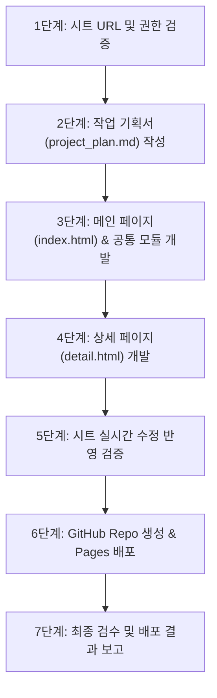

# 구글 시트 실시간 연동 정적 웹사이트 구축 & GitHub Pages 배포 스킬

본 가이드는 구글 스프레드시트를 실시간 DB(Headless CMS)로 활용하여 정적 웹 호스팅(GitHub Pages) 환경에서도 **시트 수정 내용이 사이트에 즉시 반영되는 메인/상세 2페이지 웹사이트**를 체계적으로 기획, 개발, 검증, 배포하는 표준 프로세스를 정의합니다.

---

## 🎯 적용 시나리오
- 행사, 연수, 강좌, 도서, 공지사항 등 관리자가 구글 시트로 데이터를 관리하고 웹사이트에 실시간 노출해야 하는 경우
- 별도의 백엔드/서버리스 DB 구축 없이 100% 무료 정적 웹(GitHub Pages)으로 서비스를 론칭해야 하는 경우
- 검색, 다중 필터, 정렬, 상세 페이지 라우팅이 필요한 2페이지(List & Detail) 구조 포털 구축 시

---

## 📋 핵심 원칙 및 사전 점검

### 1. 구글 시트 gviz CSV 호출 원칙
- **기본 엔드포인트**:
  `https://docs.google.com/spreadsheets/d/{SPREADSHEET_ID}/gviz/tq?tqx=out:csv&sheet={SHEET_NAME}&headers=1`
- **필수 주의사항**:
  - `headers=1` 파라미터 누락 시 구글 시트가 여러 행의 데이터를 헤더로 오인할 수 있으므로 반드시 명시합니다.
  - 시트 접근 권한은 반드시 구글 드라이브 **[일반 액세스] &rarr; "링크가 있는 모든 사용자(뷰어)"**로 설정되어야 합니다. (로그인 필요 시 HTTP 302 리다이렉트 발생)
  - 브라우저 캐싱 방지를 위해 호출 시 `&_t=${Date.now()}` 타임스탬프와 `cache: 'no-cache'` 옵션을 필수 적용합니다.
- **파서**: 쉼표 및 따옴표, 개행을 안전하게 처리하기 위해 `PapaParse` CDN을 사용합니다.

### 2. 단계별 검증 원칙 (Step-by-Step)
작업은 반드시 한 번에 한 단계씩 진행하며, 각 단계의 산출물과 정상 동작(HTTP 상태 코드, 문법 검사 등)을 검증한 후 다음 단계로 이행합니다.

### 3. 디렉토리 명명 규칙
- 루트 작업 경로 하위에 **작업 일자(`YYYY-MM-DD`) 폴더**를 생성하고 모든 산출물(코드, 기획서, 백업 데이터)을 해당 폴더에 격리 저장합니다.

---

## 🚀 7단계 표준 작업 절차 (SOP)



---

### [1단계] 구글 시트 공유 URL 및 권한 검증
1. 제공받은 구글 시트 ID 및 시트명을 확인합니다.
2. `curl.exe` 또는 Python으로 비로그인 상태의 익명 HTTP GET 요청을 전송하여 접근성을 점검합니다.
   ```bash
   curl -s -L "https://docs.google.com/spreadsheets/d/{ID}/gviz/tq?tqx=out:csv&sheet={SHEET}&headers=1"
   ```
3. HTTP 302 리다이렉트(`ServiceLogin`)가 발생하는 경우 사용자에게 일반 액세스("링크가 있는 모든 사용자-뷰어") 변경을 안내하고, 개발 진행을 위한 로컬 백업/테스트 데이터셋(`raw_data.csv`)을 생성합니다.

---

### [2단계] 작업 기획서(`project_plan.md`) 작성
1. 오늘 날짜 폴더(`YYYY-MM-DD`)를 생성합니다.
2. 프로젝트 개요, 브랜드 디자인 가이드(기관 컬러, 타이포그래피), 디렉토리 구조, 페이지별 구성요소, 기능 단위 분해 명세서를 마크다운 파일로 작성합니다.
   ```text
   {YYYY-MM-DD}/
   ├── project_plan.md       # 작업 기획서
   ├── raw_data.csv          # 테스트/백업 데이터
   ├── index.html            # 메인 페이지 (목록/검색/필터)
   ├── detail.html           # 상세 페이지 (단일 항목 상세/신청)
   └── assets/
       ├── css/style.css     # 커스텀 테마 스타일
       └── js/
           ├── config.js     # 시트 URL 및 환경설정
           ├── api.js        # PapaParse 기반 실시간 fetch 모듈
           ├── main.js       # 메인 인터랙션 로직
           └── detail.js     # 상세 조회 및 동적 렌더링 로직
   ```

---

### [3단계] 메인 페이지(`index.html`) & 공통 모듈 개발
1. **디자인 시스템 구축 (`frontend-design` 스타일)**:
   - 기관/브랜드 시그니처 컬러 변수 정의 (예: PNU Navy `#003B71`)
   - Pretendard 한글 웹폰트 및 Tailwind CSS CDN 연동
   - 카드 호버 리프트업, 스켈레톤 로딩 애니메이션 구현
2. **실시간 데이터 로더 구현 (`api.js`)**:
   - `fetch(`${CONFIG.SHEET_URL}&_t=${Date.now()}`, { cache: 'no-cache' })` 호출
   - 구글 로그인 HTML 반환 또는 네트워크 에러 시 `raw_data.csv`로 자동 Fallback
   - 다양한 시트 헤더 컬럼명(한글/영문)을 표준 객체 키로 유연하게 매핑하는 정규화 로직 적용
3. **메인 화면 구성 (`main.js`, `index.html`)**:
   - 상단 히어로 배너 및 실시간 요약 카운터 (총 건수, 모집중 건수, 분야 수)
   - 실시간 디바운스(150~200ms) 키워드 검색
   - 카테고리 칩 원클릭 필터링, 대상/교육방식/상태 드롭다운 다중 필터
   - 정렬(시간순, 가나다순) 및 필터 초기화 버튼
   - 반응형 카드 그리드 (카드 클릭 시 `detail.html?id={ID}`로 이동)
4. **로컬 웹 서버 검증**: Python 임시 서버를 띄워 HTTP 200 및 `node -c` 문법 검사를 수행합니다.

---

### [4단계] 상세 페이지(`detail.html`) 개발
1. **URL 파라미터 파싱 (`detail.js`)**:
   - `new URLSearchParams(window.location.search).get('id')`로 선택된 항목 ID 추출
   - `api.js`의 공통 fetch 함수를 호출하여 해당 ID 데이터 조회 (예외 시 친절한 안내 화면 출력)
2. **상세 화면 구성**:
   - 네비게이션 Breadcrumbs (`홈 > 목록 > 과정명`)
   - 과정 Hero (카테고리 뱃지, 이수구분, 과정명, 주관부서)
   - 핵심 요강 그리드 (일정, 시수, 대상, 정원, 신청기간, 장소)
   - 과정 상세 소개 및 차시별 커리큘럼 타임라인 시각화
   - 온라인 신청 외부 링크 버튼 및 링크 복사(토스트 알림) 기능
   - 하단 동일 분야/유사 연수 추천 큐레이션 영역

---

### [5단계] 구글 시트 실시간 수정 반영 검증
1. 구글 스프레드시트의 특정 셀 값(예: 과정명, 일정, 시간 등)을 변경합니다.
2. 사이트 새로고침 시 코드 재배포 없이 변경된 값이 즉시 화면에 동기화되는지 확인합니다.
3. 데이터 소스 상태 뱃지(실시간 연동 성공 시각)가 올바르게 갱신되는지 확인합니다.

---

### [6단계] GitHub 저장소 생성 & GitHub Pages 배포
1. Git 저장소 초기화 및 커밋:
   ```bash
   git init -b main
   git add .
   git commit -m "feat: 구글 시트 연동 웹사이트 구축"
   ```
2. GitHub CLI(`gh`)를 활용한 공개(Public) 저장소 생성 및 푸시:
   ```bash
   gh repo create {REPO_NAME} --public --source=. --remote=origin --push
   ```
3. GitHub Pages 활성화 (REST API 호출):
   ```bash
   gh api --method POST "repos/{OWNER}/{REPO}/pages" -f "source[branch]=main" -f "source[path]=/"
   ```
4. GitHub Actions 배포 워크플로우 감시 및 완료 대기:
   ```bash
   gh run watch {RUN_ID} --repo {OWNER}/{REPO}
   ```
5. 배포된 `https://{OWNER}.github.io/{REPO}/` URL로 HTTP GET 요청(curl)을 보내 200 OK를 검증합니다.

---

### [7단계] 최종 검수 및 보고
- 배포된 라이브 사이트 URL, GitHub 저장소 링크, 로컬 디렉토리 경로를 사용자에게 깔끔하게 정리하여 전달합니다.

---

## 💡 자주 발생하는 문제 및 해결 방법 (Troubleshooting)

| 문제 현상 | 원인 | 해결책 |
| :--- | :--- | :--- |
| **HTTP 302 / 로그인 화면 표시** | 구글 시트가 비공개이거나 조직 전용으로 제한됨 | 구글 드라이브 [공유] &rarr; [일반 액세스]를 **"링크가 있는 모든 사용자(뷰어)"**로 변경 |
| **헤더가 데이터 10여 개와 뭉쳐서 나옴** | gviz API의 헤더 행 자동 감지 오류 | 요청 URL 끝에 반드시 `&headers=1` 파라미터 추가 |
| **시트를 수정했는데 새로고침해도 안 바뀜** | 브라우저 또는 CDN HTTP 캐싱 | 요청 URL에 `&_t=${Date.now()}` 추가 및 fetch 옵션에 `cache: 'no-cache'` 지정 |
| **GitHub Pages 404 에러** | 배포 빌드가 완료되지 않았거나 경로 불일치 | `gh run list`로 배포 액션 성공 여부를 확인하고 1~2분 후 재접속 |
